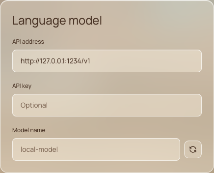
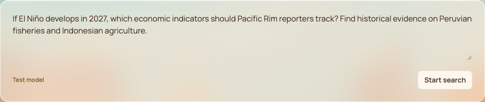
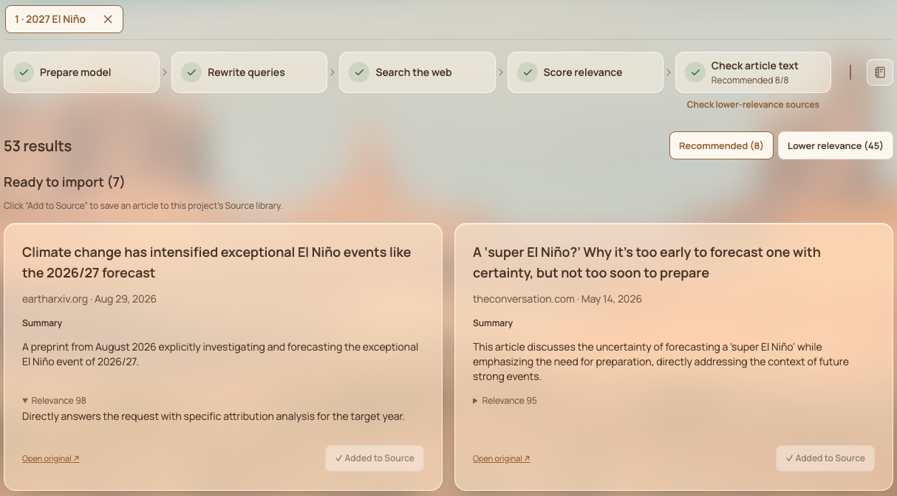
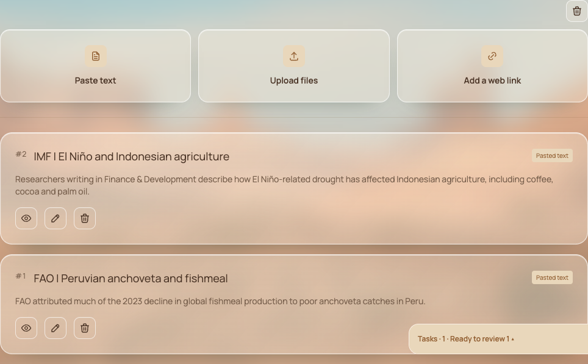
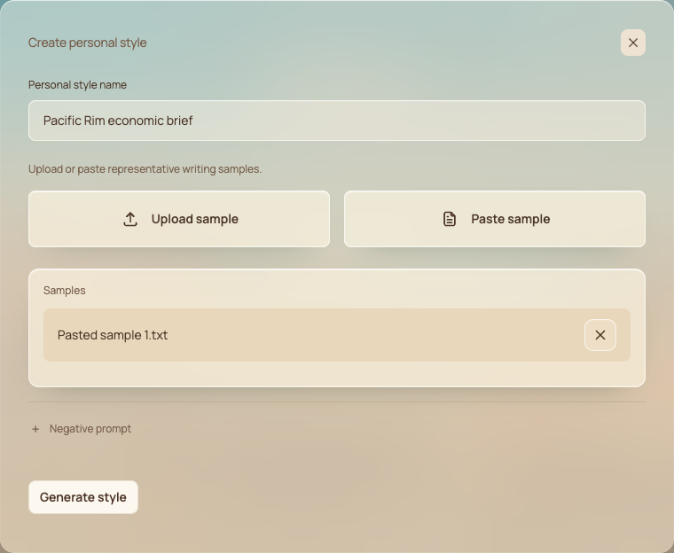
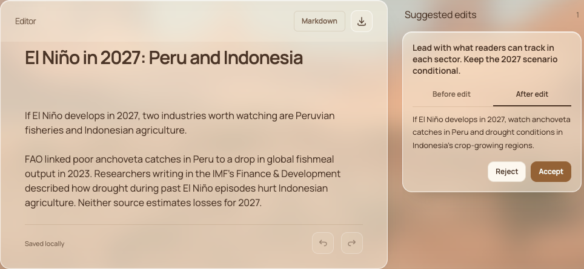

# Newsdesk

**English** · [简体中文](README.zh-CN.md)

Newsdesk is a local writing app for journalists built on **Tiiny Pocket**. Keep sources, research notes and drafts together in a project on your Mac. Search for reporting material or import your own, choose a writing style or extract one from samples, then draft a story and review suggested edits one passage at a time.

## Run on a Mac

The source build has been tested on **Apple Silicon** with Node.js 24.21.0. Intel Mac users can try the same steps with Intel-compatible tools. That configuration still needs testing.

### First launch

1. Install Node.js 22.13 or later with npm, and install uv. Open a new Terminal window and check that each command below prints a version. macOS also needs its standard `tar` utility. [Node.js downloads](https://nodejs.org/en/download) · [uv installation guide](https://docs.astral.sh/uv/getting-started/installation/)

   ```sh
   node -v
   npm -v
   uv --version
   ```

2. On this repository's GitHub page, choose **Code → Download ZIP**, then unzip it in Finder. In Terminal, type `cd` followed by a space, drag the extracted folder into the window and press Return. The folder should contain `package.json`.

3. Run these commands in order. The first two need internet access. They install the app dependencies and set up the built-in SearXNG search service and its Python environment.

   ```sh
   npm ci
   SEARCH_UV="$(command -v uv)" npm run setup:search
   npm start
   ```

4. Open [Newsdesk on this Mac](http://127.0.0.1:43219/) in your browser. Keep Terminal open while you work.

### Open it again

In the same project folder, run `npm start` and open the local address above. To stop the app and its search service, press **Control-C** in Terminal. Closing the browser tab leaves the service running.

## Run on Windows with PowerShell

1. Install the Windows version of **Node.js 24** with npm. The reported Windows test used Node.js 24.22.1. [Download Node.js](https://nodejs.org/en/download)
2. On the repository page, choose **Code → Download ZIP**. In File Explorer, select **Extract All**, then open the extracted folder that contains `package.json`. Type `powershell` in the Explorer address bar and press Enter to open PowerShell in that folder.
3. Run the commands below one at a time. The first two should print version numbers. Wait for the dependency installation to finish before starting Newsdesk.

   ```powershell
   node -v
   npm.cmd -v
   npm.cmd ci
   npm.cmd start
   ```

4. When the terminal prints the local address, open [Newsdesk on this PC](http://127.0.0.1:43219/). Keep PowerShell open. To write your first draft, connect a model under **Settings → Models** and add a document or paste notes in **Source library**. Press **Ctrl+C** in PowerShell to stop Newsdesk. Next time, open PowerShell in the same folder and run `npm.cmd start`.

**Web search on Windows.** The app can start even if it reports that built-in search is unavailable. For Research with this checkout, open **Settings → Models → External search service (optional)**, enable **Use external SearXNG** and enter the address of a SearXNG instance that supports JSON search results. Research also needs the model connection described below.

A separate Windows test ran built-in SearXNG natively with local changes to the Python environment path, settings file handling and search worker startup and shutdown. The setup script in this checkout still expects `venv/bin/python`. The Windows changes and the test machine’s custom launcher are outside this checkout.

## Try your first story

**What could El Niño mean for Pacific Rim economies in 2027?** In this walkthrough, you’ll use two historical examples to write a short explainer for business readers. The sources cover fisheries in Peru and agriculture in Indonesia. Treat the 2027 scenario as an open question throughout the story.

### 1. Connect a model

Open the gear menu and select **Settings → Models**. Under **Language model**, enter the **API address** and **Model name** for your Chat Completions-compatible service. Add an **API key** if your provider requires one, then test the connection. The screenshot shows an example address for a model running locally.



### 2. Create a project and collect evidence

On the home page, select **Start writing** and name your project **El Niño in 2027: Pacific Rim economies**. Open **Research**, enter `2027 El Niño` and select **Start search**.

In one saved search, Newsdesk returned **53 results**. It recommended **8** and could read the full text of **7** of those eight. Start with **Recommended** and open the original articles. The model scores how closely each title and snippet fits your query. Use that score to choose what to read first. The likelihood of El Niño in 2027 is a separate scientific question.

| Result from this search | Relevance | What to look for |
| --- | --- | --- |
| [EarthArXiv preprint on exceptional El Niño events](https://eartharxiv.org/repository/view/14692/) | 98/100 | The assumptions behind the 2026–27 forecast. |
| [SSRN paper on Pacific Island preparedness](https://www.ssrn.com/abstract=7689802) | 95/100 | How island communities might plan infrastructure, staffing and budgets. This result required manual text import. |
| [The Conversation on uncertainty around a “super El Niño”](https://theconversation.com/a-super-el-nino-why-its-too-early-to-forecast-one-with-certainty-but-not-too-soon-to-prepare-282574) | 95/100 | How to discuss preparedness while the strength of a future event is uncertain. |

When a result has readable text, select **Add to Source** to keep it. For a result marked for manual import, open the original and use **Paste article text** to add the text you can access.

To narrow the search to the two economies in this story, try the following question.

> If El Niño develops in 2027, which economic indicators should Pacific Rim reporters track? Find historical evidence on Peruvian fisheries and Indonesian agriculture.





*In the saved search for “2027 El Niño”, Newsdesk recommended 8 of 53 results and could read the full text of 7. Expand a relevance score to see why an article matched the query.*

For the Peru–Indonesia comparison, the author separately added two historical sources as notes. To follow along, open **Source library**, choose **Paste text** and include the source link in each note. You can also use **Upload files** or **Add a web link**.

- **Peru.** FAO linked the drop in global fishmeal production in 2023 mainly to poor Peruvian anchoveta catches. That gives the story a concrete indicator to track. [FAO fishmeal market review](https://www.fao.org/in-action/globefish/news-events/news/news-detail/2024-fishmeal-exports-bounce-back--china-dominates-imports--fish-oil-trade-declines/en)
- **Indonesia.** Researchers writing in the IMF’s *Finance & Development* discuss how drought affected Indonesian agriculture during past El Niño episodes. [El Niño: Good Boy or Bad?](https://www.elibrary.imf.org/abstract/journals/022/0053/001/article-A010-en.xml)



### 3. Draft an explainer

Open **Write**, select both sources, choose **Explainer** as the style and **English** as the output language. Give the model a reader, a reporting angle and an evidence requirement, then select **Run**.

> If El Niño develops in 2027, what could it mean for Pacific Rim economies? Write a short explainer for business readers. Compare fisheries in Peru with agriculture in Indonesia. Attribute the historical evidence and flag what remains unknown.


If you cover this beat regularly, you can save a personal style. Open **Styles**, create a style such as **Pacific Rim economic brief** and add a representative piece of your own writing with **Upload sample** or **Paste sample**. Select **Generate style**, review the rules and select **Save style** to use them on future stories.



### 4. Revise the lead

In the editor, select the sentence that introduces the two sectors. Ask for a more specific lead and run the edit.

> Lead with what readers can track in each sector. Keep the 2027 scenario conditional.

Under **Suggested edits**, switch between **Before edit** and **After edit**. The suggested lead names two things to watch, anchoveta catches in Peru and drought conditions in Indonesia’s crop-growing regions. It keeps the opening “If El Niño develops in 2027.” Select **Accept** to use the revision or **Reject** to keep the original. Once the draft is saved locally, you can reopen the project to continue writing. Use the download button in the editor to export the finished story.



The interface supports English, Spanish, French, Simplified Chinese, Japanese and Korean.

## Storage, backups and privacy

All projects share one local SQLite library. The default file is `~/Documents/Newsdesk/Newsdesk.newsdesk`. Use **Settings → System → Local storage** to change the folder. **Backup history** lets you back up or restore the whole library. Backups are in the adjacent `Newsdesk Backups/` folder. Restoring creates a snapshot of the current library first. To move to another Mac, stop Newsdesk before copying the library and the backups you want to keep.

API keys are stored in the current browser and may need to be entered again if you clear its data. Online searches send queries to search providers and request pages from source websites. When you run a remote model task, the configured service receives the prompt and the material needed for that task, such as selected sources, draft context or writing samples.

## Troubleshooting

| What you see | What to do |
| --- | --- |
| Terminal cannot find `node`, `npm` or `uv` | Install the missing prerequisite, reopen Terminal, then repeat the version checks. |
| The local page does not open | Check that `npm start` is still running. If the port is in use, run `PORT=43220 npm start` and open [port 43220](http://127.0.0.1:43220/). |
| Built-in search fails to start | Rerun the `setup:search` command above in the project folder. If the worker starts and fails, check `.runtime/search/service.log`. |
| A result opens but its article text cannot be imported | Dynamic pages may require Chrome or Chromium on the Mac. For a custom installation, set `NEWSROOM_BROWSER_PATH` to the browser executable before starting Newsdesk. You can also open the original article and paste its text. |

## Development and license

Run `npm test` for unit and integration tests. With Google Chrome installed, run `npm run verify:ux` for browser checks using a temporary library. [Verification record](docs/VERIFICATION.md)

Newsdesk's own code is available under the [MIT License](LICENSE). Bundled assets and third-party components have their own terms. [Third-party notices](THIRD-PARTY-NOTICES.md)
