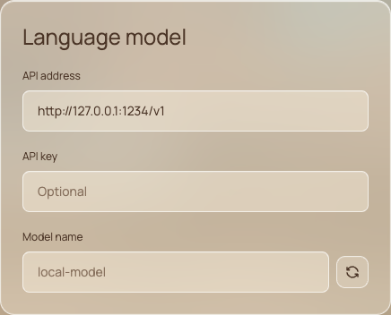
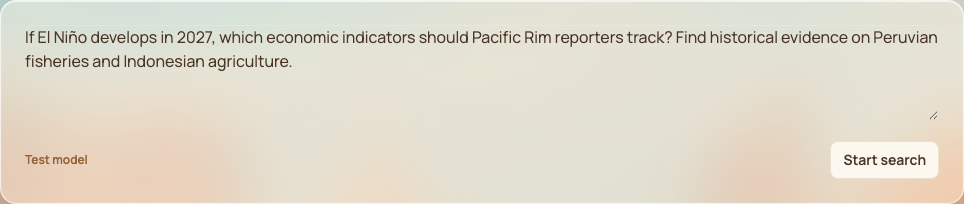
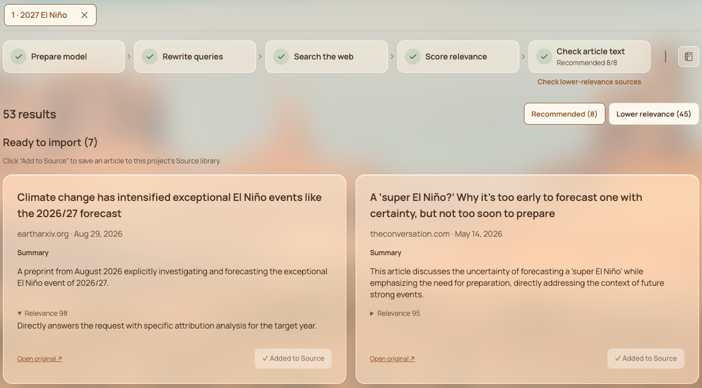
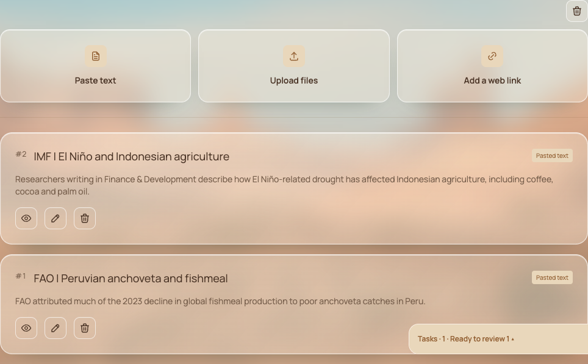
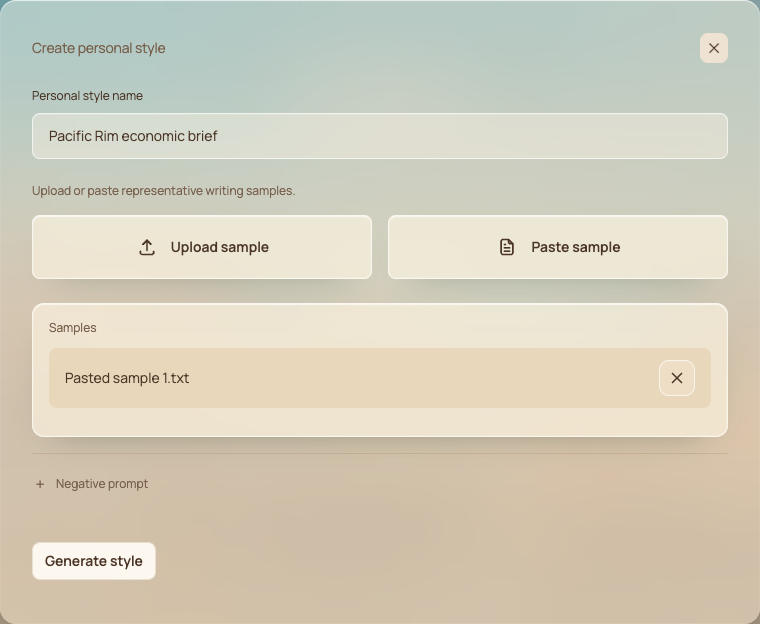
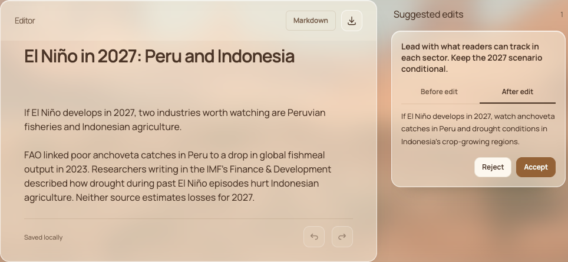

# Newsdesk

[English](README.md) · **简体中文**

Newsdesk 是一款基于 **Tiiny Pocket** 的本地新闻写作应用。你可以围绕一个选题，在同一个项目里完成以下工作。

- **按需写稿**：勾选素材，写明给谁看、从什么角度写、写多长，就能生成初稿。同一批素材可以写成一则简讯，也可以写成一篇解释性报道。
- **搜索新闻素材**：输入选题，查看按相关性排序的报道，核对原文后即可将需要的文章加入素材库。
- **导入新闻素材**：上传已有文档、粘贴采访笔记或添加报道链接，写稿时可以和搜到的材料一起使用。
- **选择或创建文风**：直接选用内置文风，或用自己的代表作生成个人文风。生成的文风规则可以编辑、保存，在下次写稿时使用。

## 在 Mac 上运行

源码版已在 **Apple 芯片 Mac** 上使用 Node.js 24.21.0 验证。Intel Mac 可安装适用于 Intel 的工具并尝试相同步骤，该配置仍待实机验证。

### 首次启动

1. 安装 Node.js 22.13 或更高版本及随附的 npm，再安装 uv。新开一个「终端」窗口，确认以下命令都能显示版本号。安装过程还会用到 macOS 自带的 `tar`。[下载 Node.js](https://nodejs.org/en/download) · [uv 安装指南](https://docs.astral.sh/uv/getting-started/installation/)

   ```sh
   node -v
   npm -v
   uv --version
   ```

2. 在本仓库的 GitHub 页面选择 **Code → Download ZIP**，在「访达」中解压。在终端输入 `cd` 和一个空格，把解压后的文件夹拖入终端窗口，再按回车。该文件夹里应有 `package.json`。

3. 依次执行以下命令。前两条需要联网，分别安装应用依赖、内置 SearXNG 搜索服务及其 Python 环境。

   ```sh
   npm ci
   SEARCH_UV="$(command -v uv)" npm run setup:search
   npm start
   ```

4. 在浏览器中打开[这台 Mac 上的 Newsdesk](http://127.0.0.1:43219/)。使用期间保持终端窗口开启。

### 以后打开

在同一个项目文件夹里运行 `npm start`，再打开上面的本机地址即可。退出时在终端按 **Control-C**，应用与搜索服务会一起停止。只关闭浏览器标签页，服务仍会运行。

## 在 Windows 上用 PowerShell 运行

1. 安装 Windows 版 **Node.js 24** 和随附的 npm。同事在 Windows 上测试时使用的是 Node.js 24.22.1。[下载 Node.js](https://nodejs.org/en/download)
2. 在仓库页面选择 **Code → Download ZIP**。在文件资源管理器中右键 ZIP，选择「全部提取」。打开解压后包含 `package.json` 的文件夹，在地址栏输入 `powershell` 并按回车。
3. 在 PowerShell 中逐行执行以下命令。前两行应显示版本号。等第三行装好依赖后，再运行第四行启动 Newsdesk。

   ```powershell
   node -v
   npm.cmd -v
   npm.cmd ci
   npm.cmd start
   ```

4. 终端显示本机地址后，在浏览器中打开[这台电脑上的 Newsdesk](http://127.0.0.1:43219/)，使用期间保持 PowerShell 开启。第一次写稿，先在「设置 → 模型设置」连接模型，再去「素材库」上传文档或粘贴笔记。退出时在 PowerShell 按 **Ctrl+C**。下次在同一文件夹打开 PowerShell，运行 `npm.cmd start` 即可。

**在 Windows 上搜索新闻素材。** 即使终端提示内置搜索未安装，仍可打开应用、导入素材和写稿。要在当前源码版使用 Research，请进入「设置 → 模型设置 → 外部搜索服务（可选）」，勾选「改用外部 SearXNG」，填入支持 JSON 搜索结果的 SearXNG 实例地址。Research 也需要连接模型。

同事已在 Windows 原生环境跑通内置搜索，测试时调整了 Python 虚拟环境路径、配置文件写入方式，以及搜索进程的启动和退出逻辑。当前仓库的搜索安装脚本仍使用 `venv/bin/python`，同事的 Windows 适配改动及自制启动脚本尚未收录。

## 试写第一篇稿件

**示例选题：2027 年厄尔尼诺现象可能对环太平洋地区产生哪些经济影响？**

我们为财经读者写一篇解释性报道，从两个可查证的切口入手：秘鲁渔业和印度尼西亚农业。截图使用 Newsdesk 英文界面，搜索词、写作要求和稿件均为英文示例。两份选材提供历史背景，2027 年的影响作为条件情景讨论。

### 1. 连接写作模型

首次使用时，打开右上角齿轮，进入 **Settings → Models**。在 **Language model** 中填写服务商提供的 **API address** 和 **Model name**。模型服务需兼容 Chat Completions。若服务商要求认证，填写 **API key**。最后测试连接。图中显示的是本机地址示例。



### 2. 建立项目，找到能支撑选题的材料

在首页点 **Start writing**，将新项目命名为 **El Niño in 2027: Pacific Rim economies**。打开 **Research**，输入 `2027 El Niño`，点击 **Start search**。

在一次保存的搜索中，Newsdesk 返回了 **53 条结果**，其中 **8 条进入推荐组，7 条可自动读取全文**。先看 **Recommended**，打开感兴趣的原文核对。模型根据标题和摘要评估每条结果与选题的相关性，分数可以帮助决定先读哪篇。判断 2027 年发生厄尔尼诺的概率，还需要查看科学预测本身。

| 本次搜索结果 | 相关性 | 原文值得看什么 |
| --- | --- | --- |
| [EarthArXiv 上关于极端厄尔尼诺事件的预印本](https://eartharxiv.org/repository/view/14692/) | 98/100 | 2026–27 年预测基于哪些假设。 |
| [SSRN 上关于太平洋岛国应对厄尔尼诺的论文](https://www.ssrn.com/abstract=7689802) | 95/100 | 岛国如何规划基础设施、人手和预算。这一条需要手动导入正文。 |
| [The Conversation 对“超级厄尔尼诺”预测不确定性的解读](https://theconversation.com/a-super-el-nino-why-its-too-early-to-forecast-one-with-certainty-but-not-too-soon-to-prepare-282574) | 95/100 | 在事件强度仍不确定时，怎样报道各地的准备工作。 |

对可读取正文的结果，点击 **Add to Source** 加入素材库。对提示手动导入的结果，打开原文，通过 **Paste article text** 粘贴可以访问的正文。

要把范围缩小到本篇报道关注的两个经济体，可以接着搜索下面这个问题。

> If El Niño develops in 2027, which economic indicators should Pacific Rim reporters track? Find historical evidence on Peruvian fisheries and Indonesian agriculture.





*在已保存的“2027 El Niño”搜索中，53 条结果里有 8 条获推荐，其中 7 条可读取全文。展开相关性分数，就能看到一篇文章为什么与选题匹配。*

为了比较秘鲁和印尼，作者另外选取了两份历史资料，整理成笔记加入素材库。跟做时，打开 **Source library**，用 **Paste text** 粘贴笔记并附上原文链接。已有文档和网页也可以通过 **Upload files** 或 **Add a web link** 导入。

- 秘鲁案例关注鳀鱼捕捞量如何影响鱼粉供应。FAO 在回顾 2023 年的产量变化时，将全球鱼粉减产主要归因于秘鲁鳀鱼捕捞不佳。[FAO 鱼粉市场回顾](https://www.fao.org/in-action/globefish/news-events/news/news-detail/2024-fishmeal-exports-bounce-back--china-dominates-imports--fish-oil-trade-declines/en)
- 印尼案例关注干旱如何影响农业。研究者在 IMF《Finance & Development》撰文，讨论了以往厄尔尼诺时期的干旱及其对印尼农业的影响。[IMF：El Niño: Good Boy or Bad?](https://www.elibrary.imf.org/abstract/journals/022/0053/001/article-A010-en.xml)



### 3. 用同一批材料写一篇解释性报道

进入 **Write**，勾选刚才的两份素材，文风选 **Explainer**，输出语言选 **English**。在输入框写明读者、比较对象和证据要求，然后点 **Run**。

> If El Niño develops in 2027, what could it mean for Pacific Rim economies? Write a short explainer for business readers. Compare fisheries in Peru with agriculture in Indonesia. Attribute the historical evidence and flag what remains unknown.


如果你常写这一类报道，可以在 **Styles** 中创建个人文风，例如 **Pacific Rim economic brief**。用 **Upload sample** 或 **Paste sample** 加入自己的代表作，点 **Generate style**，审阅生成的规则后点 **Save style**。下次写稿时就能直接选用。



### 4. 把笼统的导语改成读者能追踪的指标

示例导语提到了秘鲁渔业和印尼农业。要让读者知道具体该观察什么，在编辑器里选中这句，输入修改要求并执行：

> Lead with what readers can track in each sector. Keep the 2027 scenario conditional.

在 **Suggested edits** 中切换 **Before edit** 和 **After edit**。图中改后的句子点出了秘鲁鳀鱼捕捞量和印尼作物产区的干旱状况，同时保留了 “If El Niño develops in 2027” 这一条件。点 **Accept** 采纳，或点 **Reject** 保留原句。编辑器显示 **Saved locally** 后，下次打开项目即可继续。定稿可从编辑器右上角的下载按钮导出。



界面支持英语、西班牙语、法语、简体中文、日语和韩语。

## 数据、备份与隐私

所有项目共用一份本地 SQLite 资料库，默认文件是 `~/Documents/Newsdesk/Newsdesk.newsdesk`。在「设置 → 系统 → 本地存储」可更改保存目录，在「备份历史」可备份或恢复整个资料库。备份位于同目录的 `Newsdesk Backups/` 文件夹。恢复前，应用会先保存当前资料库的快照。迁移到另一台 Mac 时，先停止 Newsdesk，再复制资料库和需要保留的备份。

API 密钥保存在当前浏览器里，清除浏览器数据后可能需要重新填写。联网搜索会向搜索服务发送查询，读取文章时会访问原网站。运行远程模型任务时，所配置的服务会收到提示词以及当次所需的内容，例如所选素材、稿件上下文或文风样本。

## 常见问题

| 遇到的问题 | 处理方式 |
| --- | --- |
| 终端提示找不到 `node`、`npm` 或 `uv` | 安装缺少的工具，重新打开终端，再运行版本检查命令。 |
| 本机网页打不开 | 确认 `npm start` 仍在运行。如果提示端口被占用，运行 `PORT=43220 npm start`，再打开 [43220 端口](http://127.0.0.1:43220/)。 |
| 内置搜索无法启动 | 在项目目录重新执行上面的 `setup:search` 命令。如果搜索进程启动后退出，查看 `.runtime/search/service.log`。 |
| 找到了文章，但无法自动导入正文 | 部分动态网页需要本机安装 Chrome 或 Chromium。使用自定义路径时，在启动 Newsdesk 前将 `NEWSROOM_BROWSER_PATH` 设为浏览器可执行文件路径。也可以打开原文并粘贴正文。 |

## 开发与许可

运行 `npm test` 执行单元和集成测试。安装 Google Chrome 后，可运行 `npm run verify:ux`，用临时资料库验证浏览器交互。[查看验证记录](docs/VERIFICATION.md)

Newsdesk 自有代码采用 [MIT 许可证](LICENSE)。随附素材与第三方组件分别适用各自条款。[查看第三方说明](THIRD-PARTY-NOTICES.md)
